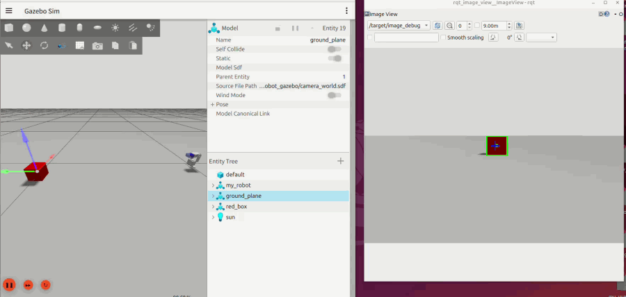

# ros2-yuntai-learn

一个用 ROS 2 (Jazzy) 从零搭起来的**二自由度云台**学习项目：从 URDF 建模、Gazebo 仿真、
MoveIt 2 运动规划，到真机飞特（Feetech）舵机硬件接口，最后接上视觉做**红块识别 + 自动追踪**，
整条链路全部打通。



*Gazebo 仿真中：左为仿真场景，右为相机画面，绿色框是识别到的红块，蓝色十字是画面中心。
`target_tracker` 会让云台转动，把红块"搬"到中心。*

---

## 功能

| 模块 | 说明 |
| --- | --- |
| URDF 建模 | 两关节云台（`yuntai_joint1` 偏航 / `yuntai_joint2` 俯仰），带相机连杆 |
| Gazebo 仿真 | `gz_ros2_control` 仿真控制器 + 相机传感器 + 红色方块场景 |
| MoveIt 2 | 规划组 `yuntai_planning_groups`，可通过 RViz 拖拽或代码下发关节目标 |
| 真机硬件接口 | `ros2_control` 插件，直接驱动飞特 SMS/STS 总线舵机（串口） |
| 视觉识别 | OpenCV HSV 阈值分割红色目标，输出 `vision_msgs/Detection2DArray` |
| 目标追踪 | 由像素偏差反解关节角度，通过 MoveIt 动作接口持续对准目标 |

## 环境

- Ubuntu 24.04
- ROS 2 **Jazzy**
- Gazebo Sim（`ros_gz_*`，随 Jazzy 自带）
- MoveIt 2
- Python 依赖：`opencv-python`、`numpy`（视觉包）；`cv_bridge`、`vision_msgs`（ROS 包）

```bash
sudo apt install ros-jazzy-ros-gz ros-jazzy-ros-gz-sim ros-jazzy-ros-gz-bridge \
                 ros-jazzy-ros-gz-image ros-jazzy-gz-ros2-control \
                 ros-jazzy-moveit ros-jazzy-moveit-configs-utils \
                 ros-jazzy-vision-msgs ros-jazzy-rqt-image-view
```

## 编译

```bash
cd ~/ros2_ws          # 或本仓库所在目录
colcon build --symlink-install
source install/setup.bash
```

## 运行

### 1. 只看 URDF（RViz + 关节滑条）

```bash
ros2 launch my_robot_description display.launch.py
```

### 2. 仿真 + MoveIt + 视觉追踪（完整体验）

一条命令拉起：Gazebo 场景、`robot_state_publisher`、`move_group`、RViz、
控制器 spawn、相机桥接、图像窗口。

```bash
ros2 launch my_robot_gazebo sim.launch.py
```

再开一个终端启动视觉节点：

```bash
source install/setup.bash
ros2 launch my_robot_vision vision.launch.py
```

`target_detector` 订阅 `/camera/image`，发布 `/target/detections` 和调试图像 `/target/image_debug`；
`target_tracker` 订阅检测结果，通过 `/move_action` 让云台对准红块。目标丢失时会自动扫描搜索。

### 3. 用代码控制云台（MoveIt 关节目标）

```bash
ros2 run my_robot_moveit_demo yuntai_move_group_ctrl
```

目标角度在脚本里的 `node.go_to_joint_target(-1.57, 3.14)` 处修改（单位：弧度）。

### 4. 真机（飞特舵机）

`src/my_robot_description/urdf/my_robot.ros2_control.xacro` 里默认用的是真机插件：

```xml
<plugin>my_robot_hardware/YuntaiHardwareInterface</plugin>
<param name="port">/dev/ttyACM0</param>
<param name="joint1_motor_id">1</param>
<param name="joint2_motor_id">2</param>
```

需要按实际情况修改串口和舵机 ID，并给串口权限：

```bash
sudo chmod 666 /dev/ttyACM0        # 或把用户加入 dialout 组
```

> 仿真用的是 `gz_ros2_control/GazeboSimSystem`（见 `my_robot_gazebo/urdf/my_robot_gazebo.urdf.xacro`），
> 真机用的是 `my_robot_hardware/YuntaiHardwareInterface`，两套 `<ros2_control>` 不要同时挂上。

## 包结构

```
src/
├── my_robot_description/       # URDF/Xacro 模型、mesh、RViz 配置、只显示模型的 launch
├── my_robot_gazebo/            # Gazebo 仿真：世界文件、仿真 URDF、一键 launch
├── my_robot_hardware/          # 真机 ros2_control 硬件接口插件 + 飞特 SDK
│   ├── ftservo_sdk/            #   厂商 SDK（scservo_sdk）+ serial 第三方库
│   ├── include|src/            #   YuntaiHardwareInterface、FeetechDriver
│   └── docs/                   #   硬件接口逐行讲解（两篇长文）
├── my_robot_moveit_config/     # MoveIt Setup Assistant 生成的配置（SRDF/控制器/运动学）
├── my_robot_moveit_demo/       # 通过 MoveGroup 动作接口控制云台的示例脚本
└── my_robot_vision/            # 红块识别 + 目标追踪节点
```

## 主要话题 / 接口

| 名称 | 类型 | 说明 |
| --- | --- | --- |
| `/camera/image` | `sensor_msgs/Image` | Gazebo 相机桥接过来的图像 |
| `/target/detections` | `vision_msgs/Detection2DArray` | 检测到的目标框 |
| `/target/image_debug` | `sensor_msgs/Image` | 画了框和中心十字的调试图 |
| `/move_action` | `moveit_msgs/MoveGroup` | MoveIt 规划+执行动作接口 |
| `yuntai_planning_groups_controller` | `JointTrajectoryController` | 云台关节轨迹控制器 |

## 说明

- 视觉识别用的是最简单的 HSV 颜色阈值，只认红色方块，对光照比较敏感。
- `target_tracker` 的可调参数（死区、增益、最大步长、扫描位姿等）都是 ROS 参数，
  可以在 launch 里用 `parameters=[{...}]` 覆盖。
- 硬件相关细节请看 `src/my_robot_hardware/docs/` 下的两篇文档，写得非常详细。